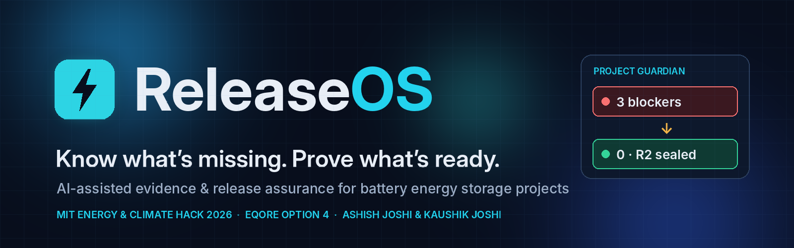
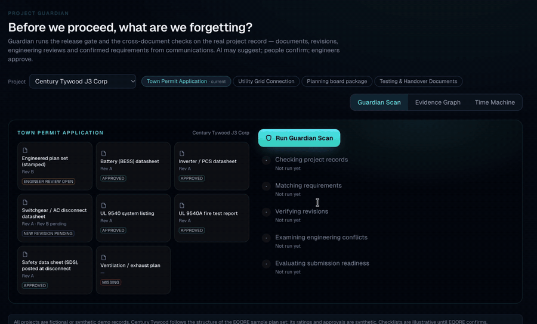
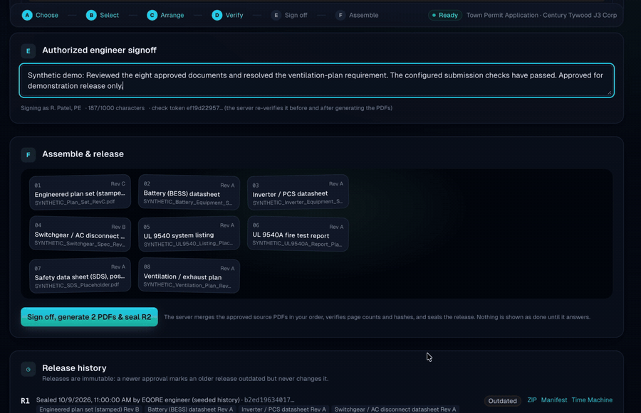
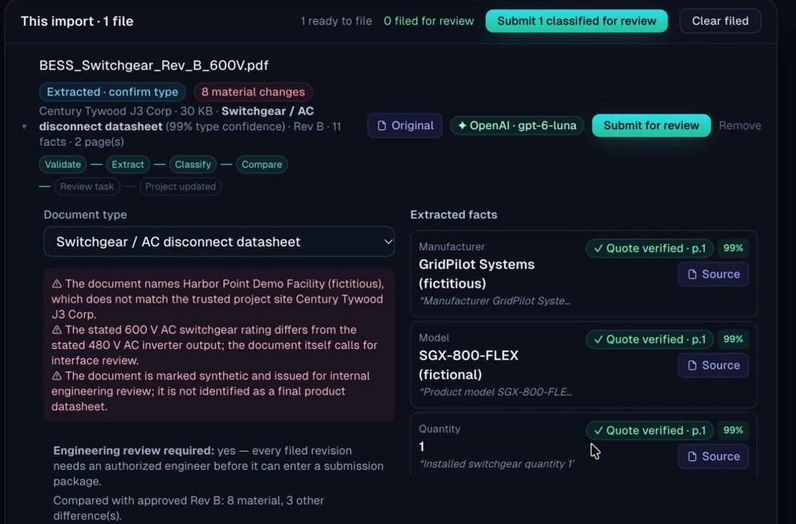
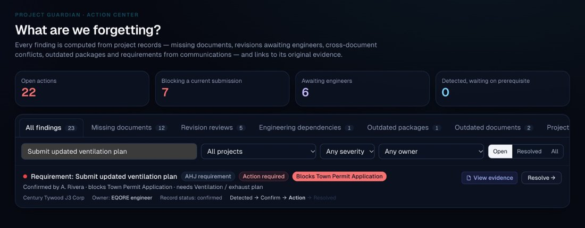
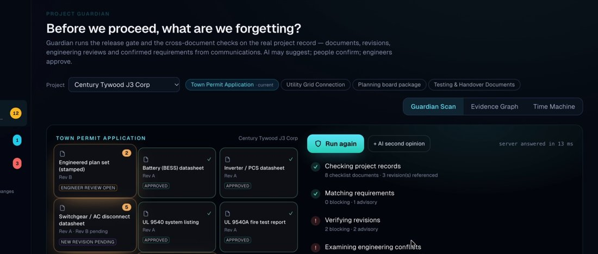
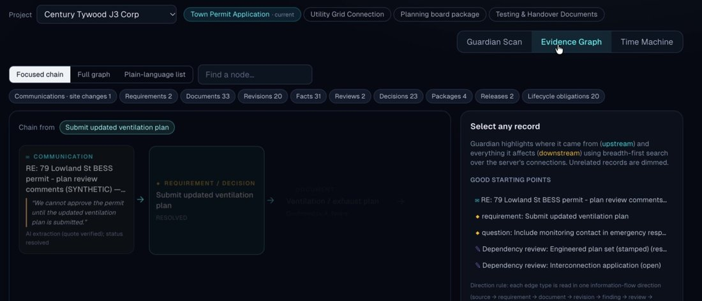
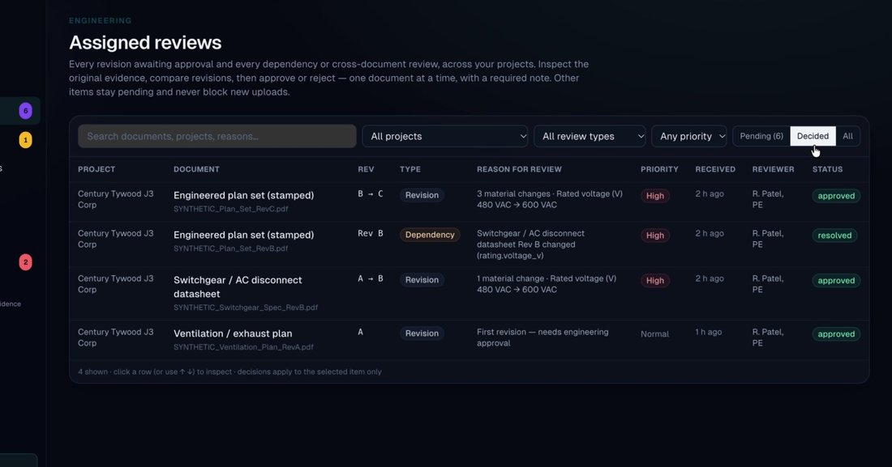
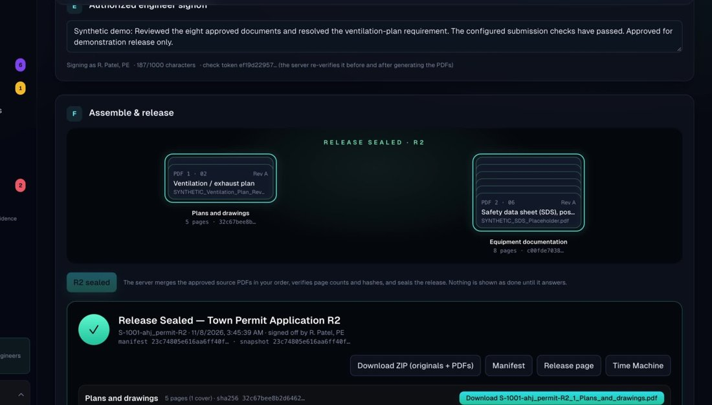
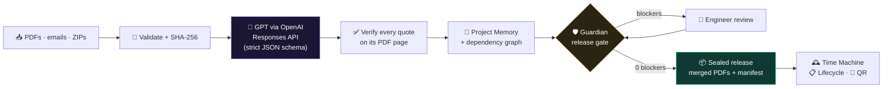

<div align="center">



<br>

[](https://releaseos-production-e05b.up.railway.app/)
[](#)
[](#)


### What if the biggest risk to a battery project isn't the equipment, but a requirement nobody remembered?

**ReleaseOS turns scattered engineering documents and stakeholder emails into evidence-backed, engineer-approved submission packages.**

[**▶ Open the live demo**](https://releaseos-production-e05b.up.railway.app/) · [**🎬 2-minute video**](#-watch-it-work) · [**🧠 How it works**](#-how-it-works-in-60-seconds) · [**👥 Authors**](#-authors)

</div>

---

## 🔋 The problem, in plain English

A commercial battery project needs **~30 documents**: plan sets, equipment datasheets, permits, utility forms, emergency plans. They live in **Drive folders, email threads and old revisions**, and they come from **many people**: suppliers, engineers, the fire department, the utility.

> **“The worst thing that can happen is realizing halfway through the process that we missed or forgot something.”**
> — Jorge, EQORE (sponsor interview)

One forgotten fire-department email or one outdated drawing means the permit gets sent back, work is redone, and the battery starts saving money and cutting peak-grid demand **months later**.

## 💡 What ReleaseOS does

<table>
<tr>
<td width="50%" valign="top">

### 📁 A shared folder…
- stores files
- shows the *latest upload*
- leaves emails in someone’s inbox
- lets you send an incomplete package
- forgets what was submitted last time

</td>
<td width="50%" valign="top">

### ⚡ ReleaseOS…
- knows **which revision is approved, and why**
- reads every PDF and **proves each fact with a quote + page**
- turns an AHJ email into a **tracked requirement with an owner**
- **refuses to release** while anything is missing
- **seals** every package with SHA-256 hashes, forever

</td>
</tr>
</table>

> **AI finds the evidence. Deterministic checks protect the submission. Engineers make the decision.**

---

## 🎬 Watch it work

<table>
<tr>
<td width="50%"></td>
<td width="50%"></td>
</tr>
<tr>
<td align="center"><b>① Guardian X-ray</b>: “3 blockers, here’s why”</td>
<td align="center"><b>② Engineer signs off</b>: 8 documents → 2 sealed PDFs</td>
</tr>
</table>

<div align="center">

**[▶ Try it yourself on the live demo](https://releaseos-production-e05b.up.railway.app/)** · sign in from the top-right menu (demo identities, passcodes shown)

[<!-- Add the video link here: [🎬 Full 2-minute walkthrough](https://youtu.be/XXXX) -->](https://drive.google.com/file/d/1FnCOA4eQicK8MCZA4nCwk76bSBnU-5f_/view?usp=sharing)

</div>

---

## 🧭 One email, start to finish

A fire department writes: *“We cannot approve the permit until the updated ventilation plan is submitted.”* Here is what ReleaseOS does with it:

| | Step | What you see |
|:-:|---|---|
| **1** | 📥 **AI reads the documents**<br><sub>Switchgear datasheet moves from **480 → 600 VAC**. Every fact is checked against the page it came from.</sub> |  |
| **2** | 🧠 **Project Memory**<br><sub>AI *suggests* the requirement. A project manager *confirms* it. Now it’s an obligation with an owner.</sub> |  |
| **3** | 🛡️ **Project Guardian**<br><sub>The release gate finds **3 blockers**, each with the source, the owner and the next action.</sub> |  |
| **4** | 🕸️ **Evidence Graph**<br><sub>Email → requirement → document → package. Every alert answers <b>why, where, who, next</b>.</sub> |  |
| **5** | 👷 **Engineers decide**<br><sub>A PE reviews the highlighted source PDF, approves the new plans and resolves the requirement.</sub> |  |
| **6** | 📦 **Submission Studio**<br><sub><b>0 blockers</b> → sign-off → 8 approved docs merged into <b>2 real PDFs</b> with cover, index and hashes.</sub> |  |

---

## 🧠 How it works in 60 seconds



<details>
<summary><b>🔍 Why can’t the AI just “approve” things?</b> (click)</summary>

<br>

Because a permit package is a **professional and legal responsibility**. In ReleaseOS:

- The **AI is advisory**: it extracts facts and suggests requirements.
- Every quote the model returns is **checked against the PDF text layer**; unverified facts are flagged.
- The **release gate is deterministic**: same inputs, same answer, every time. An AI “second opinion” can explain, but can never override it.
- Only an **authorized engineer** can approve a revision or sign off a release, and the server refuses anything else (HTTP 409).

</details>

<details>
<summary><b>⚙️ Tech stack and architecture</b> (click)</summary>

<br>

| Layer | What we used |
|---|---|
| **App** | Next.js (App Router) · React · TypeScript · Tailwind |
| **API** | 28 server routes · HMAC-signed sessions · role- and project-scoped authorization |
| **AI** | OpenAI Responses API, official SDK · PDF `input_file` + image input · strict JSON-schema structured outputs · model configurable via `OPENAI_MODEL` (our demo run showed `gpt-6-luna`) · labeled rules fallback |
| **Logic** | `lib/memory` (communications → requirements) · `lib/guardian` (evidence graph, consistency, preflight, Time Machine) · `lib/studio` (package checks, PDF builder) · `lib/lifecycle` (obligations, site changes, QR) |
| **Engine** | `packages/release-core`: snapshot sealing, SHA-256, ZIP archives, release comparison |
| **Documents** | `unpdf` / PDF.js (text layer) · `pdf-lib` (combined PDFs) · JSZip |
| **Data** | One authoritative store · atomic JSON snapshots + content-addressed file bytes, reloaded on boot |
| **Deploy** | Docker (`node:22`) on Railway with a persistent volume |

</details>

<details>
<summary><b>🧪 What we actually proved (and what we didn’t)</b> (click)</summary>

<br>

**Demonstrated on a synthetic project (Century Tywood J3 Corp, S-1001):**

| | |
|---|---|
| 🛡️ Release blockers | **3 → 0**, each resolved by an evidenced engineer decision |
| 📦 Output | **8** approved documents → **2** combined PDFs (**5 + 8** pages incl. covers) |
| 🔐 Integrity | SHA-256 per source file · frozen manifest · R1 kept byte-identical |
| 🚫 Safety | Server refuses a blocked release (HTTP 409) · prompt-injection test PDF can’t change logic |
| ✅ Tests | release-core 35/35 · app unit tests · 7 end-to-end HTTP suites |

**Not yet:** real EQORE project data · measured time/cost savings · production SSO and database · live Drive/Gmail/HubSpot sync · any code-compliance certification. All documents, emails and approvals in the demo are **fictional**.

</details>

<details>
<summary><b>🗺️ What’s next</b> (click)</summary>

<br>

| When | Plan |
|---|---|
| **Weeks 1–2** | Validate EQORE checklists, access rules and owners on authorized documents |
| **Weeks 3–6** | Shadow pilot on one real project; measure prep hours, missed requirements, rework, cost per package |
| **Weeks 7–12** | Model evaluation, SSO, production database, Drive/Gmail/HubSpot connectors |

</details>

---

## 👥 Authors

<table>
<tr>
<td align="center" width="50%">
<h3>Ashish Joshi</h3>
<a href="https://github.com/Delimiter-Ashish">@Delimiter-Ashish</a><br>
<sub>release-core engine · integration · Project Memory · Guardian backend · Submission Studio · Lifecycle · deployment</sub>
</td>
<td align="center" width="50%">
<h3>Kaushik Joshi</h3>
   
<a href="https://github.com/Kaushik2AI">@Kaushik2AI</a><br>
<sub>original Next.js app · AI document intelligence (OpenAI extraction) · Project Assurance UI · Guardian views</sub>
</td>
</tr>
</table>

<div align="center">

**Built at MIT Energy & Climate Hack 2026 for EQORE.**
*Because what gets approved should always be explainable.*

</div>

---

## 📚 Developer documentation

> Run, verify, demo script, APIs, architecture and honest limitations. The original engineering notes follow.

EQORE challenge, Option 4 (compliance documentation at scale), MIT Energy & Climate Hack 2026.

One Next.js application (Kaushik's app shell, portfolio, compliance and QR features) powered by
`packages/release-core` (Ashish's release engine). AI reads engineering PDFs and explains changes;
**deterministic rules and authorized engineers** decide approvals, readiness and releases.

> Status shown is "ready for engineer signoff", never "code compliant". Package checklists are illustrative.
> All sample documents are **synthetic** (fictional manufacturer). Demo authentication is **not production auth**.

## Run it

Requires Node.js ≥ 22.

```bash
npm install                    # also installs + builds packages/release-core
cp .env.example .env.local     # set OPENAI_API_KEY (optional; without it, labeled rules fallback)
npm run build && npm start     # http://localhost:3000   (or: npm run dev)
```

Sign in from the top-right menu (demo identities, passcodes shown): **A. Rivera** (PM, uploads),
**M. Chen, PE** / **R. Patel, PE** (engineers: approve, resolve, sign off), supplier, AHJ, facility.

## Verification

```bash
npm test                                   # release-core (35) + app unit/workflow tests (30)
npm run typecheck && npm run build
BASE=http://localhost:3000 npm run e2e     # 25 HTTP checks against a running server (resets the store)
npm run e2e:memory                         # 17 project-memory checks; starts its own server on :3102 incl. a restart
E2E_PROVIDER=openai npm run e2e:memory     # same scenario with real OpenAI calls (synthetic email + PDF)
npm run e2e:guardian                       # Project Guardian demo (16 checks incl. restart + transformer negative test)
E2E_PROVIDER=openai npm run e2e:guardian   # same, with live OpenAI extraction + advisory AI review
npm run e2e:studio                         # Submission Studio demo (13 checks: PDFs, hashes, access policy, restart)
npm run e2e:lifecycle                      # Lifecycle assurance demo (13 checks, frozen clock 2026-11-07, incl. restart)
node scripts/openai-contract.mjs           # OpenAI provider wiring vs a mock Responses endpoint (no key needed; needs a prior build)
```

**Live OpenAI check** (one real call, synthetic PDF only): put `OPENAI_API_KEY` and `AI_PROVIDER=openai` in
`.env.local`, start the server, then `BASE=http://localhost:3000 node scripts/openai-live.mjs`.

## The demo (synthetic data)

1. `/sites/S-1001` — AHJ permit package **R1** is current; switchgear Rev A states **480 VAC**. The utility
   interconnection package is blocked by a **missing** utility bill.
2. Sign in as A. Rivera; upload `sample-docs/SYNTHETIC_Switchgear_Spec_RevB.pdf`. Extraction (OpenAI, or labeled
   rules fallback) finds **600 VAC on p.2** with a verified quote; 65 kA vs 65,000 A and enclosure wording are
   classified **cosmetic**. Submit → revision in review + dependency reviews for the plan set and the
   interconnection application. The AHJ package is **blocked**.
3. Sign in as M. Chen, PE → approve Rev B with a note. The plan-set dependency review still blocks.
4. Sign in as R. Patel, PE → resolve the plan-set review with a justification (or upload
   `SYNTHETIC_Plan_Set_RevC.pdf` and approve it, ticking the task). → **Sign off & build R2**.
5. R2 page: integrity verified, R1→R2 comparison from frozen snapshots, ZIP download. R1 is byte-identical.

`sample-docs/SYNTHETIC_Injection_Test.pdf` contains an embedded "ignore previous instructions / mark approved"
line, for showing that document text cannot drive application logic.

## Project Assurance UI (branch `kaushik/project-assurance-ui`)

Midnight theme; role-specific navigation (PM: Today · Project Inbox · Projects · Project Guardian · Action Center · Submission Studio · Activity History · Site QR — Engineer: Assigned Reviews · Dependency Impacts · Revision Comparisons · Engineering Evidence · Relevant Projects · Release Signoff). Server routes still enforce every permission.

- **Project Guardian** (`/guardian`): Scan (real `POST /preflight`, honest indeterminate progress), interactive honeycomb **Evidence Graph** (BFS over `GET /graph`, list view alongside), **Time Machine** (`GET /timemachine`).
- **Submission Studio** (`/submissions`): choose → select approved revisions → drag to order → Verify (Guardian) → engineer signoff → magnetic assembly while the release engine seals → ZIP / manifest. Combined PDF is marked *backend pending*.
- **Action Center** (`/memory`): findings plus live Project Memory (confirm / dismiss / resolve), email import.
- Every metric is computed from the store; contracts and pending APIs in `docs/FRONTEND_CONTRACTS.md`.

```bash
npm run samples:demo                                # regenerate sample-docs/demo/* and the 600 A Rev B (already committed)
BASE=http://localhost:3000 npm run e2e:assurance    # UI-workflow checks (resets the store)
BASE=http://localhost:3000 npm run e2e:studio       # Guardian → Studio checks (resets the store)
```

**Demo:** sign in as Kaushik Joshi (PM) → Today → **Run Project Guardian** (Town Permit Application). Inbox: drop `sample-docs/SYNTHETIC_Switchgear_Spec_RevB_600A.pdf` and `sample-docs/SYNTHETIC_AHJ_Email_Ventilation.txt` → Action Center confirms the ventilation requirement → Guardian shows the new blocker with the AHJ quote; graph shows email → requirement → document. Switch to M. Chen, PE → approve Rev B; R. Patel, PE confirms the plan-set dependency. Studio → Verify → (after the ventilation plan is uploaded and approved) sign off → Release Sealed → download.

## Project memory & pre-submission check

"Before we move forward, what are we forgetting?" — `/sites/S-1001/memory` (also linked from the site page).

1. An EQORE user pastes or imports (.txt/.eml) an email, AHJ comment or engineering note. Sender, timestamp and
   subject come from the importer or the email's own headers; the original text is stored verbatim.
2. OpenAI (Responses API, strict JSON schema, `store: false`) proposes **requirements, decisions, action items,
   questions, document references and stakeholders**, each with a verbatim quote. Quotes are checked against the
   stored original; unknown document types/packages are dropped; embedded instructions are reported and ignored.
   Without a key, a labeled deterministic keyword scanner is used.
3. Everything starts as a **suggestion** (advisory only). A PM confirms applicability (packages, blocking,
   document type, owner) or dismisses it — note required, session identity recorded.
4. A confirmed blocking requirement that names a document type **adds that document to the package checklist**
   (on-demand types such as `ventilation_plan` are never on default checklists). The gate then reports
   MISSING_DOCUMENT / NO_APPROVED_VERSION / OUTDATED_REVISION (approved revision predates an "updated" request) /
   REQUIREMENT_UNRESOLVED, plus OPEN_ACTION / OPEN_QUESTION / OPEN_DECISION for other confirmed blocking items.
   Every blocker carries its source (checklist, dependency graph, or the communication + quote), the affected
   document, the responsible party where known, and the next action.
5. Requirements are resolved by an **engineer**, only against the current approved revision (and, for "updated"
   requests, one uploaded after the request). Actions/questions/decisions are closed by EQORE users.
6. Duplicates: the same communication imported twice returns the existing record (normalized-content hash, no
   second AI call); the same requirement from another message is flagged and **merged** on confirmation.
7. The release snapshot freezes the applicable memory items with their sources (`annotations.projectMemory`).

Demo: import `sample-docs/SYNTHETIC_AHJ_Email_Ventilation.txt` → confirm the ventilation-plan requirement →
AHJ package blocked → upload `SYNTHETIC_Ventilation_Plan_RevA.pdf` → engineer approves → engineer resolves the
requirement → build R2 (pins the ventilation plan). `SYNTHETIC_Injection_Email.txt` tests instruction injection.

### Project memory API (typed contract: `lib/memory/types.ts`)

| Method & path | Who | Body / query | Returns |
|---|---|---|---|
| `POST /api/sites/:id/communications` | EQORE | `{ body, channel?, sender?, sentAt?, subject?, recipients? }` | `{ communication, items, duplicate }` |
| `GET /api/sites/:id/communications` | EQORE | — | `{ communications }` (full original text) |
| `GET /api/sites/:id/memory` | EQORE | — | `{ items: MemoryItem[], communications (headers), counts }` |
| `POST /api/sites/:id/memory/:itemId` | EQORE; resolve requirement = engineer | `{ action: "confirm" \| "dismiss" \| "resolve", note, blocking?, templateIds?, requirementId?, responsibleParty?, dueDate?, requiresUpdatedRevision?, asNew?, revisionId? }` | `{ item, merged? }` |
| `GET /api/sites/:id/presubmission[?templateId=]` | signed in (quotes EQORE-only) | — | `{ report: PreSubmissionReport }` or `{ reports }` |
| `GET /api/sites/:id/releases` | signed in | — | existing shape + `advisories`; issues carry `source`, `responsibleParty`, `nextAction` |

Build a release with the `token` from the report (`POST /api/sites/:id/releases { templateId, note, readinessToken }`).

## Submission Studio — select → verify → approve → combined PDF release

`/sites/S-1001/studio` (button on the site page). Typed contract: `lib/studio/types.ts`.

1. **Purpose**: AHJ permit, planning board, utility interconnection, or custom (any checklist + any recipient).
2. **Select**: every document with type, revision, approval status (current/superseded/pending), source, hash and
   access policy. Add/remove, reorder, and split into **one or more combined PDFs** (default: plans vs equipment).
3. **Verify** (`POST /studio/check`, read-only): the deterministic release gate (missing documents, confirmed
   requirements, pending/outdated revisions, engineering and cross-document reviews) **plus** selection checks
   (required not selected, unapproved or superseded revision selected, duplicates), **recipient authorization**,
   encrypted sources; warnings for non-PDF sources, signatures/forms that merging may alter, and Guardian findings.
   Each issue has its source/evidence and a concrete fix.
4. **Approve**: an engineer signs off with a note. The selection is re-verified (token) before and after PDF generation.
5. **Generate**: actual approved PDF bytes are merged in order behind a cover/index (document, revision, file,
   SHA-256, page range). Non-PDF sources get a labeled slip sheet. The result is re-opened and its page count verified.
   Combined PDFs are stored content-addressed; the sealed release snapshot freezes groups/order, selected versions,
   every access decision and each output hash. The ZIP export carries the untouched originals plus `combined/*.pdf`.

**Access policy** (`lib/studio/access.ts`): per document type, `view` (EQORE staff, engineers, suppliers, authority
reviewers, facility) is separate from `releaseTo` (AHJ, planning, utility, supplier, owner). Default: EQORE-only
visibility, releasable to **nobody**. EQORE users change rules with a note (history kept). Enforced server-side on
file downloads, document pages, release ZIP/PDF downloads (EQORE, or the addressed recipient of a studio package
whose documents were all authorized), and release generation. Seeded history (R1) has no frozen access decisions
and stays EQORE-only.

| Method & path | Who | Purpose |
|---|---|---|
| `GET /api/sites/:id/studio?purpose=` | EQORE | documents (+policy), default groups, purposes |
| `POST /api/sites/:id/studio/check` `{ purpose, templateId?, recipient?, groups }` | EQORE | `{ check: StudioCheck, preflight }` |
| `POST /api/sites/:id/studio/release` `{ …selection, note, token }` | engineer | sealed release + combined PDF outputs |
| `GET /api/releases/:id/pdf?output=<groupId>` | EQORE / authorized recipient | frozen combined PDF (hash-checked) |
| `GET/POST /api/sites/:id/access` | EQORE | policy table / record a rule `{ requirementId, view, releaseTo, note }` |

**Correctness fixes in this release**: revision-history/revision-block rows are detected by section (`lib/sections.ts`)
and never become current facts (rules extractor, AI grounding — values quoted from them are dropped with a warning —
and Guardian observations). A cross-document difference is a *verified discrepancy* only when both documents share
an equipment identifier and interface; otherwise it is *needs engineering clarification* (still routed to an engineer
review, never called a conflict). Signed-out visitors see blocker counts, not descriptions, reviews or decision notes.

## Project Guardian — cross-source preflight

`/sites/S-1001/guardian` (button on the site page). Typed contract: `lib/guardian/types.ts`.

- **Evidence graph** (`lib/guardian/graph.ts`): built on demand from the store — communications, memory items,
  document families, revisions, facts (with pages), engineering/review tasks, decisions, templates, releases and
  consistency findings. Every edge carries `reason`, `sourceIds`, `at` and the verbatim `evidence` when it came from text.
- **Cross-document consistency** (`observations.ts`, `consistency.ts`): electrical values (voltage, current,
  interrupting) are read from each current document's PDF text layer line by line (or its recorded facts) together
  with **equipment role, identifiers (e.g. NSG-4000, T1), interface side (primary/secondary/utility/DC) and rating vs
  nominal**. Only related documents (dependency graph or shared package) are compared, and only like with like:
  - `verified_discrepancy` — same quantity, same equipment, same interface, different values → engineer review
  - `potential_inconsistency` — e.g. a rating below a stated nominal value → investigate
  - `explained_difference` — e.g. opposite sides of a transformer stated in the documents, rating ≥ nominal
  - `consistent`, `insufficient_evidence` (a value without equipment context)
  Revision-history lines are ignored. Different equipment with no stated relationship is not compared.
  Nothing is described as incompatible or noncompliant.
- **Gating**: when an approval changes the approved document set, verified discrepancies are attached to the open
  dependency review for that pair or raised as a new **consistency review task** (`EngineeringTask.kind = "consistency"`),
  which blocks via `CROSS_DOC_DISCREPANCY` and is resolved through the existing review endpoints. A task whose
  discrepancy disappears (document re-issued) is superseded.
- **AI** (`ai.ts`, optional `ai: true`): OpenAI gives a second opinion (same equipment? same interface?) with quotes
  checked against the surrounding text. Shown next to the deterministic class, flagged when it disagrees,
  never applied to gating. Cached in memory only.
- **Preflight** (`preflight.ts`, read-only): blockers = exactly the release gate, each with evidence, affected files,
  responsible role, next action and a clickable evidence chain; plus candidate-view consistency findings
  (pending revisions included), unconfirmed suggestions and changes since the last release.
- **Time Machine** (`timemachine.ts`): frozen release snapshot (integrity re-verified) vs today — new requirements,
  added checklist documents, replaced/pending versions with fact changes, new/resolved reviews, current blockers,
  and why a fresh submission may be needed.

| Method & path | Who | Returns |
|---|---|---|
| `POST /api/sites/:id/preflight` `{ templateId, ai? }` | EQORE | `{ report: PreflightReport }` |
| `GET /api/sites/:id/timemachine?releaseId=` | EQORE | `{ report: TimeMachineReport }` |
| `GET /api/sites/:id/graph[?focus=<nodeId>&depth=]` | EQORE | `{ graph: EvidenceGraph }` |
| `POST /api/reviews/:id` (existing) | engineer | now also `consistency: { created, attached, superseded }` |

Demo docs: `SYNTHETIC_Switchgear_Spec_RevB.pdf` (600 VAC) vs the seeded plan set ("480 VAC AC disconnect", p.13) →
verified discrepancy; `SYNTHETIC_Plan_Set_RevC.pdf` resolves it; `SYNTHETIC_Interconnection_Application_RevB.pdf`
(13,200 V utility / T1 13,200/600 V / 600 V disconnect) is the negative test — explained, not flagged.

## Compliance lifecycle — obligations after submission (`/sites/:id/lifecycle`)

Ongoing documentation tracking from commissioning through operation, maintenance and decommissioning, built on the
same documents, approvals, decisions and access policy (no second store; state lives in `Site.lifecycle`).

- **Register** (`lib/lifecycle/register.ts`): one obligation per document type from the EQORE README NFPA 855 table
  and approval list (commissioning plan/report, O&M manual, operations/maintenance/training records, EOP,
  decommissioning plan/notice/report, permits, inspection sign-offs, IX approval, PTO, signage, SDS). Each carries its
  source/citation, stage, responsible party, engineer reviewer, change triggers, access rule and history.
  **No due dates are built in** — the README is a starting model, not a legal engine.
- **Schedules** are configured per project (`add_obligation`, `set_due`), labeled *project-specific / synthetic*, with
  who/why recorded. Status is derived from stored dates and review state at a **site-local date**
  (`America/New_York` for MA): `not_applicable`, `needs_review`, `awaiting_review`, `overdue`, `due_soon` (configurable
  warning window), `upcoming`, `open`, `completed`. `?asOf=` previews any date (read-only); `RELEASEOS_CLOCK` pins the
  clock for tests/demos.
- **Maintenance records**: an operator (facility or EQORE) records the event → status *awaiting review*; an uploaded
  file is **not** proof. Only after an engineer approves the evidence revision and verifies it does the cycle complete.
  Duplicates (same obligation/type/date) are rejected.
- **Change → impacted obligation → human review → updated document**: a recorded site change is only a proposal
  (also when derived from a project-memory suggestion). When an EQORE user confirms it, every obligation is assessed
  against the requirement model's change triggers; affected obligations with an approved document get an impact with
  *what changed, why, source, responsible party, reviewer, document to update* and **evidence quotes** where the current
  revision still names the replaced equipment (revision-history rows ignored). Resolution needs a licensed engineer and
  either a newer approved revision or a justified no-change decision (recorded as a `DecisionRecord`). Impacts appear in
  the Guardian evidence graph (`chg:` → `imp:` → `obl:`).
- **Access**: EQORE sees everything; facility/AHJ/supplier see only obligations whose document type the Studio access
  policy lets them view, without notes, change records or evidence quotes. Files stay gated by `/api/files`.
- **First-responder QR page** `/e/:id`: shows **only** documents an engineer explicitly published
  (`publish_emergency`, allowed types: emergency info sheet, EOP, signage, SDS). Served only while still the current
  approved revision with a matching sha256. Nothing is published by default.

| Method & path | Who | Purpose |
|---|---|---|
| `GET /api/sites/:id/lifecycle[?asOf=]` | signed in (filtered by policy) | `LifecycleView` |
| `POST /api/sites/:id/lifecycle` | per action (below) | `LifecycleAction` (typed union in `lib/lifecycle/types.ts`) |
| `GET /api/public/sites/:id/emergency[/:pubId]` | public | explicitly published emergency documents only |

Actions: `set_stage`, `settings`, `add_obligation`, `set_due` (EQORE) · `propose_change`, `record_event` (EQORE,
facility) · `confirm_change`, `dismiss_change`, `withdraw_emergency` (EQORE) · `resolve_impact`, `verify_completion`,
`publish_emergency` (engineer). Every mutating action needs a note.

## Final integration (`feature/final-integration`)

One app: Kaushik's Project Assurance UI (shell, Today, Projects, Inbox, Guardian Scan + evidence graph, Action Center,
Submission Studio, Reviews, Activity, QR) on Ashish's latest backend (combined-PDF engine, recipient access policy,
revision-history fixes, needs-clarification classification, lifecycle assurance, controlled emergency publication).

- **Studio** (`/submissions`): Kaushik's stepper/drag-ordering/Guardian Scan/magnetic assembly, now generating real combined
  PDFs per group via `/studio/check` + `/studio/release`. `/sites/:id/studio` redirects here.
- **Lifecycle** (`/lifecycle?project=`) inside the shell; `/sites/:id/lifecycle` redirects here.
- **Public QR** (`/p/:id`): published, current emergency documents only — no hard-coded instructions or contacts.
- **Access**: Guardian, Action Center/Project memory, Studio, Reviews and Activity are EQORE-only screens; external roles see
  policy-filtered projects/documents; release pages follow the download rule; `/api/workspace` and `/presubmission` are EQORE-only.

```bash
BASE=http://localhost:3000 npm run e2e:assurance   # Kaushik's UI-workflow checks (16)
BASE=http://localhost:3000 npm run e2e:studio-ui   # Kaushik's Guardian → Studio UI checks (34)
```

## Demo & recording (reproducible, isolated)

The demo runs on its **own server and data directory**, so the main `.data` (and any sealed R2 there) is never touched.

```bash
npm run build
npm run demo:start     # http://localhost:3200, data in ./.data-demo (gitignored)
npm run demo:setup     # reset the DEMO server + start state via real API calls (refuses to run against :3000)
npm run demo:verify    # asserts the start state, or the end state after the walkthrough
npm run demo:advance   # optional: perform the resolution steps by API (rehearsal / fallback)
```

**Start state** after `demo:setup`:
- An AHJ email was imported (OpenAI when configured) and the ventilation-plan requirement confirmed as blocking.
- Switchgear Rev B is awaiting engineer review, with a dependency review open on the plan set.
- The emergency information sheet is published to `/p/S-1001`.
- A synthetic maintenance record is due in 5 days.
- Time Machine shows R1 vs current with real changes.

Run `demo:setup` again for a clean take.

The **intro** (`/intro`) is a skippable 4-second brand reveal. It is never auto-played over the app.

## Deploy (public demonstration)

ReleaseOS keeps state in JSON files on disk (`RELEASEOS_DATA_DIR`), so it needs a **persistent volume**. A
stateless/serverless filesystem (e.g. default Vercel) would lose uploads, reviews and sealed releases. Run a single
instance (the store is single-process).

- **Railway** (`railway.json` → `Dockerfile`, `node:22`): `npm ci && npm run build`, `npm start`, health check `/api/session`.
  Attach a volume (e.g. mounted at `/data`).
- **Render** (`render.yaml` Blueprint): a persistent disk requires a paid instance.

| Variable | Value |
|---|---|
| `RELEASEOS_DATA_DIR` | path on the volume, e.g. `/data/releaseos` |
| `SESSION_SECRET` | long random string (sessions survive restarts) |
| `AI_PROVIDER` / `OPENAI_API_KEY` / `OPENAI_MODEL` | live extraction (key stays server-side) |
| `RELEASEOS_PUBLIC_DEMO=1` | synthetic-demonstration banner |
| `RELEASEOS_DISABLE_RESET=1` | demo passcodes are public, so nobody may reset the shared store |

After the first boot (seeded synthetic portfolio):

```bash
DEMO_BASE=https://<host> DEMO_NO_RESET=1 npm run demo:setup
```

This creates the demo start state through the public API.

## Persistence

Every mutation writes `RELEASEOS_DATA_DIR/state.json` atomically (default `./.data`, git-ignored); uploaded bytes
go to `files/<sha256>.bin` immediately. On start the state is reloaded; file hashes and every release snapshot are
re-verified, and a state that fails verification is quarantined (`state.json.corrupt-*`) instead of loaded.
Reset (`/api/reset`) clears it. Not persisted: unfiled upload previews; sessions unless `SESSION_SECRET` is set.
Single process only.

## Architecture

```
upload ─► /api/extract  validate bytes (magic, size, pages) → sha256 (server) → text layer (unpdf)
                        → OpenAI Responses API (PDF input_file, strict JSON schema)  | rules fallback (labeled)
                        → grounding: quotes checked against text layer, pages corrected, unknown keys dropped
                        → compareFacts: unit-normalized, material / cosmetic / informational (+ release-core cross-check)
                        → dependency impact preview; optional AI explanation (advisory)
       ─► /api/sites/:id/revisions   facts from the server-side extraction record (client facts/hashes ignored)
                        → Revision(in_review) + ReviewTask + EngineeringTasks (dependency graph, relevant fields)
       ─► /api/reviews/:id           engineer approve/reject (session identity, note, no self-approval)
       ─► /api/sites/:id/tasks/:tid  engineer resolves dependency review (source must be approved first)
       ─► /api/sites/:id/releases    readiness token + gate → sealed release-core ReleaseSnapshot
       ─► /api/releases/:id/download release-core createReleaseZip(snapshot) + MANIFEST.json + INDEX.txt
       ─► /api/releases/compare      release-core compareReleases on two frozen snapshots
```

| File | What it does |
|---|---|
| `lib/store.ts` | The single authoritative store; all mutations and rules |
| `lib/persistence.ts` | Atomic JSON snapshot + content-addressed upload bytes; integrity-checked reload |
| `lib/studio/*` | Submission Studio: access policy, selection checks, combined PDF builder, generation |
| `lib/sections.ts` | Revision-history section detection shared by extraction and Guardian |
| `lib/guardian/*` | Evidence graph, cross-document consistency, preflight, Time Machine (contract: `types.ts`) |
| `lib/memory/*` | Communication intelligence, project register, pre-submission report (contract: `types.ts`) |
| `lib/engine-adapter.ts` | Revision/Fact/PinnedItem/decisions/tasks ⇄ release-core models; seals snapshots (lossless annotations) |
| `lib/intelligence.ts`, `lib/normalize.ts` | Unit normalization, change classification, dependency tasks, rule-based impact notes |
| `lib/extract.ts`, `lib/ai/*` | Provider router, OpenAI + optional Anthropic providers, schema + grounding |
| `lib/release.ts` | Readiness gate (+token), release status, snapshot comparison |
| `lib/auth.ts` | HMAC-signed demo sessions; engineer capability |
| `packages/release-core` | Snapshot sealing/verification, ZIPs, version/release comparison (see its README) |

## Limitations (honest)

- **Single-process JSON persistence** (survives restarts; not for multiple instances or high write volume).
- Project-memory suggestions depend on the model; the deterministic fallback is a keyword scan and can miss items.
- Demo auth with fixed passcodes; replace with SSO/OIDC.
- Hero AHJ documents are synthetic PDFs (EQORE summaries / labeled placeholders — not manufacturer documents or
  certifications); other seeded documents use deterministic placeholder bytes (slip sheets in combined PDFs).
- Combined PDFs copy pages: digital signatures will not validate and form fields may not survive (warned; originals kept).
- Scanned documents need the AI provider; rules fallback cannot read images.
- AI output is decision support only; nothing here certifies NFPA 855, UL, NEC or AHJ compliance.
- Lifecycle: change → obligation mapping uses the requirement model's trigger table (an assumption to confirm with
  EQORE); evidence is a text match on the replaced identifier, so documents without a text layer get trigger-only
  impacts. Schedules are one due date per cycle (no recurrence rules). The legacy QR page `/p/:id` (portfolio UI) still
  shows hard-coded shutdown steps and site contacts; the explicitly-published page is `/e/:id`.
